# JADAVPUR UNIVERSITY
## DEPARTMENT OF COMPUTER SCIENCE AND ENGINEERING
### Computer Networks Laboratory (BCSE-III)

---

# Assignment 5: Packet Tracer and Traffic Analysis with Wireshark

**Student Name:** Mandeep Shaw  
**Roll Number:** 302510501002  
**Section:** A1  
**Course:** Computer Networks Laboratory (BCSE-III)  
**Academic Year:** 2026  
**Tools Used:** Wireshark v4.2.2, Dumpcap, `ping`, Web Browser (Firefox), Linux (`wlp1s0` & Ethernet interfaces)

---

## Table of Contents
1. [Overview and Objectives](#overview-and-objectives)
2. [Question 1: ICMP and ARP Traffic Analysis](#question-1-icmp-and-arp-traffic-analysis)
3. [Question 2: Web Traffic Analysis (HTTP, DNS, TCP, RTT, and Host IP Addresses)](#question-2-web-traffic-analysis)
4. [Question 3: Hex and ASCII Byte Representations in Packet Bytes Panel](#question-3-hex-and-ascii-byte-representations-in-packet-bytes-panel)
5. [Question 4: First 4 Bytes Hex Value of Host Header](#question-4-first-4-bytes-hex-value-of-host-header)
6. [Question 5: Protocol Filtering and Stream Reassembly (Following Network Flows)](#question-5-protocol-filtering-and-stream-reassembly)
7. [Question 6: Server HTTP Response and Ethernet Layer Inspection](#question-6-server-http-response-and-ethernet-layer-inspection)
8. [Question 7: NIC Manufacturers (Local Host vs. Server / Gateway)](#question-7-nic-manufacturers)
9. [Question 8: Organizationally Unique Identifiers (OUIs) in Raw Hex Bytes](#question-8-organizationally-unique-identifiers-ouis-in-raw-hex-bytes)
10. [Question 9: Protocol Hierarchy Statistics (TCP vs. UDP Distribution)](#question-9-protocol-hierarchy-statistics)
11. [Question 10: Traffic Flow Graph Analysis (General Flow & TCP Flow)](#question-10-traffic-flow-graph-analysis)
12. [Conclusion and Key Learnings](#conclusion-and-key-learnings)

---

## Overview and Objectives

Wireshark is an industry-standard open-source packet analysis and network forensics suite. It provides real-time capture and offline packet dissection across all layers of the OSI/TCP-IP networking model:
- **Packet List Panel:** Tabulates captured frames in chronological sequence, color-coded by protocol.
- **Packet Details Panel:** Deconstructs selected frames hierarchically across protocol layers (Physical Frame $\rightarrow$ Data Link Ethernet II $\rightarrow$ Network IPv4/IPv6 $\rightarrow$ Transport TCP/UDP/ICMP $\rightarrow$ Application HTTP/DNS/mDNS).
- **Packet Bytes Panel:** Displays the exact binary payload in hexadecimal notation alongside ASCII decoding.

The objective of this assignment is to conduct packet-level inspection and traffic analysis, capturing live network interactions including address resolution (ARP), internet control messaging (ICMP ping), web browsing (HTTP/TCP), protocol filtering, stream reassembly, hardware addressing (MAC OUIs), statistical distribution profiling, and conversational flow ladder diagrams.

---

## Question 1: ICMP and ARP Traffic Analysis

### Question Statement
> *Generate some ICMP traffic by using the Ping command line tool to check the connectivity of a neighbouring machine (or router). Note the results in Wireshark. The initial ARP request broadcast from your PC determines the physical MAC address of the network IP Address, and the ARP reply from the neighboring system. After the ARP request, the pings (ICMP echo request and replies) can be seen.*

### Experimental Procedure
1. Connected the machine to the local network interface (`10.223.117.129`).
2. Started a live Wireshark packet capture on the active network interface.
3. Executed the `ping` utility from the terminal targeted at the neighbouring host (`10.223.117.59`):
   ```bash
   ping -c 4 10.223.117.59
   ```
4. Applied the display filter `arp` to observe the address resolution phase.
5. Applied the display filter `icmp` to examine the Echo Request and Echo Reply messages.

---

### Step 1: Address Resolution Protocol (ARP)
Before IP packets can be encapsulated into physical Ethernet frames, the transmitting network stack must resolve the target IP address (`10.223.117.59`) into a 48-bit physical MAC address. Because the destination is not yet in the operating system's ARP cache, an ARP broadcast is initiated.

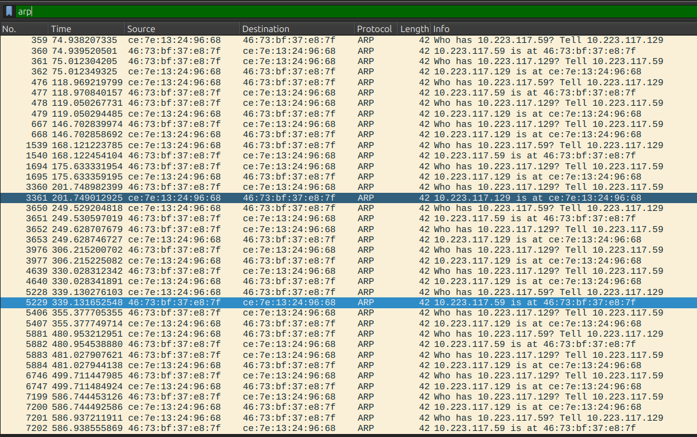

#### Packet Dissection:
- **ARP Request (Packet No. 3360 / 5228):**
  - **Broadcast MAC:** `ff:ff:ff:ff:ff:ff`
  - **Source MAC:** `ce:7e:13:24:96:68` (Local Host)
  - **Sender IP:** `10.223.117.129`
  - **Target IP:** `10.223.117.59`
  - **Info:** `Who has 10.223.117.59? Tell 10.223.117.129`
- **ARP Reply (Packet No. 3361 / 5229):**
  - **Destination MAC:** `ce:7e:13:24:96:68` (Unicast back to requester)
  - **Source MAC:** `46:73:bf:37:e8:7f` (Target Host NIC)
  - **Sender IP:** `10.223.117.59`
  - **Info:** `10.223.117.59 is at 46:73:bf:37:e8:7f`

---

### Step 2: Internet Control Message Protocol (ICMP)
With the MAC address cached, the host transmits four ICMP Echo Requests (ping) and receives matching ICMP Echo Replies.

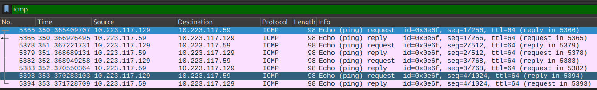

#### Packet Dissection:
| Packet No. | Time (s) | Source IP | Destination IP | Protocol | Length | Info Summary |
|---|---|---|---|---|---|---|
| **5365** | 350.365409 | `10.223.117.129` | `10.223.117.59` | ICMP | 98 | Echo (ping) request `id=0x0e6f`, `seq=1/256`, `ttl=64` (reply in 5366) |
| **5366** | 350.366926 | `10.223.117.59` | `10.223.117.129` | ICMP | 98 | Echo (ping) reply `id=0x0e6f`, `seq=1/256`, `ttl=64` (request in 5365) |
| **5378** | 351.367221 | `10.223.117.129` | `10.223.117.59` | ICMP | 98 | Echo (ping) request `id=0x0e6f`, `seq=2/512`, `ttl=64` (reply in 5379) |
| **5379** | 351.368689 | `10.223.117.59` | `10.223.117.129` | ICMP | 98 | Echo (ping) reply `id=0x0e6f`, `seq=2/512`, `ttl=64` (request in 5378) |
| **5382** | 352.368949 | `10.223.117.129` | `10.223.117.59` | ICMP | 98 | Echo (ping) request `id=0x0e6f`, `seq=3/768`, `ttl=64` (reply in 5383) |
| **5383** | 352.370550 | `10.223.117.59` | `10.223.117.129` | ICMP | 98 | Echo (ping) reply `id=0x0e6f`, `seq=3/768`, `ttl=64` (request in 5382) |
| **5393** | 353.370283 | `10.223.117.129` | `10.223.117.59` | ICMP | 98 | Echo (ping) request `id=0x0e6f`, `seq=4/1024`, `ttl=64` (reply in 5394) |
| **5394** | 353.371728 | `10.223.117.59` | `10.223.117.129` | ICMP | 98 | Echo (ping) reply `id=0x0e6f`, `seq=4/1024`, `ttl=64` (request in 5393) |

- **Type/Code:** Echo Requests use `Type 8, Code 0`. Echo Replies use `Type 0, Code 0`.
- **Latency / RTT:** Between Request 5365 ($t = 350.365409\text{ s}$) and Reply 5366 ($t = 350.366926\text{ s}$), round-trip latency was $1.517\text{ ms}$.

---

## Question 2: Web Traffic Analysis

### Question Statement
> *Generate some web traffic and:*
> - *a. Find the list of the different protocols that appear in the protocol column in the unfiltered packet-listing window of Wireshark.*
> - *b. How long did it take from when the HTTP GET message was sent until the HTTP OK reply was received? (Display Time field in time-of-day format).*
> - *c. What is the Internet address of the website? What is the Internet address of your computer?*
> - *d. Search back through your capture, and find an HTTP packet containing a GET command. Click on the packet in the Packet List Panel. Then expand the HTTP layer in the Packet Details Panel, from the packet.*
> - *e. Find out the value of the Host from the Packet Details Panel, within the GET command.*

---

### Part 2a: Observed Protocols in Unfiltered Capture

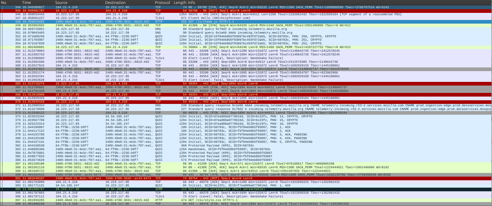

When web traffic is generated, multiple protocols across different layers of the network architecture are captured:
1. **TCP (Transmission Control Protocol):** Connection setup (SYN, SYN-ACK, ACK), reliable data stream transport, flow control, and connection teardown.
2. **TLSv1 / TLSv1.2 (Transport Layer Security):** Cryptographic handshakes, cipher negotiation, certificate exchange, and encrypted application transport.
3. **HTTP (Hypertext Transfer Protocol):** Cleartext application-layer web requests (`GET /generate_204 HTTP/1.1`) and web responses.
4. **DNS (Domain Name System):** Resolves human-readable domain names into IP addresses over UDP port 53.
5. **QUIC (Quick UDP Internet Connections):** Modern multiplexed transport protocol operating over UDP port 443 (HTTP/3).
6. **ICMP (Internet Control Message Protocol):** Control and error messaging (e.g., `Destination unreachable (Port unreachable)`).

---

### Parts 2b & 2c: HTTP Response Time (RTT) and IP Addresses

To measure the exact round-trip response time, the Time Display Format was configured to **Time-of-day** (`View -> Time Display Format -> Time-of-day`), and the display filter `http` was applied.

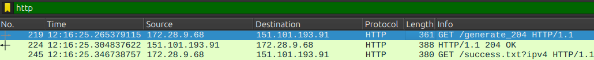

#### Captured Packet Data:
- **HTTP GET Request (Packet No. 219):**
  - **Timestamp:** `12:16:25.265379115`
  - **Source IP (Client Computer):** `172.28.9.68`
  - **Destination IP (Web Server):** `151.101.193.91`
  - **Request Line:** `GET /generate_204 HTTP/1.1`
- **HTTP OK Response (Packet No. 224):**
  - **Timestamp:** `12:16:25.304837622`
  - **Source IP (Web Server):** `151.101.193.91`
  - **Destination IP (Client Computer):** `172.28.9.68`
  - **Response Code:** `HTTP/1.1 204 OK` (No Content)

#### Calculations:
$$\text{Response Time} = T_{\text{reply}} - T_{\text{request}}$$
$$\text{Response Time} = 12:16:25.304837622 - 12:16:25.265379115 = 0.039458507\text{ seconds} \approx \mathbf{39.46\text{ ms}}$$

#### Identified Internet Addresses:
- **Internet Address of Computer (Client):** `172.28.9.68`
- **Internet Address of Website (Server):** `151.101.193.91`

---

### Parts 2d & 2e: Dissecting the HTTP GET Request and Host Header

Selecting Packet 219 in the Packet List Panel and expanding the **Hypertext Transfer Protocol** tree in the Packet Details Panel reveals the HTTP headers.

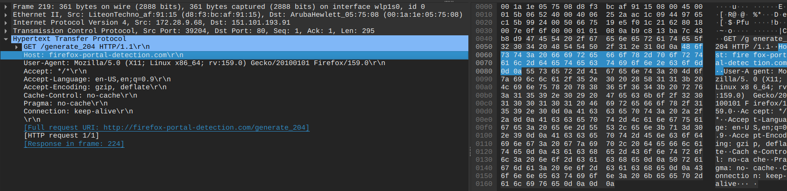

#### Protocol Breakdown:
- **Request Method:** `GET`
- **Request URI:** `/generate_204`
- **Request Version:** `HTTP/1.1`
- **Host Header:** `firefox-portal-detection.com`
- **Full Value in Details Panel:** `Host: firefox-portal-detection.com\r\n`
- **User-Agent:** `Mozilla/5.0 (X11; Linux x86_64; rv:159.0) Gecko/20100101 Firefox/159.0`
- **Accept:** `*/*`
- **Connection:** `keep-alive`

**Answer for 2e:** The value of the Host header is **`firefox-portal-detection.com`**.

---

## Question 3: Hex and ASCII Byte Representations in Packet Bytes Panel

### Question Statement
> *Highlight the Hex and ASCII representations of the packet in the Packet Bytes Panel.*

### Observation and Analysis
When the `Host: firefox-portal-detection.com\r\n` field is clicked in the Packet Details Panel (as shown in the screenshot below), Wireshark's deep packet inspection (DPI) engine dynamically highlights the corresponding raw slice in the **Packet Bytes Panel**.


- **Highlighted Hex Bytes:**
  ```hex
  48 6f 73 74 3a 20 66 69 72 65 66 6f 78 2d 70 6f
  72 74 61 6c 2d 64 65 74 65 63 74 69 6f 6e 2e 63
  6f 6d 0d 0a
  ```
- **Highlighted ASCII Representation:**
  ```text
  Host: firefox-portal-detection.com..
  ```
  *(Note: The trailing `..` represents the carriage return `\r` (`0x0d`) and line feed `\n` (`0x0a`) characters).*

This establishes the direct mapping between Wireshark's parsed protocol tree and the raw serialized octets transmitted over the physical medium.

---

## Question 4: First 4 Bytes Hex Value of Host Parameter

### Question Statement
> *Find out the first 4 bytes of the Hex value of the Host parameter from the Packet Bytes Panel.*

### Observation and Hex-to-ASCII Mapping
Referring directly to the highlighted region in `Screenshot_2026-11-06_12-22-39.png`:

| Byte Offset | Hex Value | Decimal | ASCII Character |
|:---:|:---:|:---:|:---:|
| 1st Byte | **`0x48`** | 72 | `'H'` |
| 2nd Byte | **`0x6f`** | 111 | `'o'` |
| 3rd Byte | **`0x73`** | 115 | `'s'` |
| 4th Byte | **`0x74`** | 116 | `'t'` |

**Answer:** The first 4 bytes of the Hex value are **`48 6f 73 74`**, which spells the ASCII word **`Host`**.

---

## Question 5: Protocol Filtering and Stream Reassembly

### Question Statement
> *Filter packets with http, TCP, DNS and other protocols.*
> - *a. Find out what those packets contain by following one of the conversations (also called network flows), select one of the packets and press the right mouse button..click on follow.*

---

### Step 1: Applying Protocol Display Filters

Wireshark uses Boolean display filter expressions to isolate specific protocol traffic:

#### 1. HTTP Display Filter (`http`):
Displays HTTP web requests and responses.
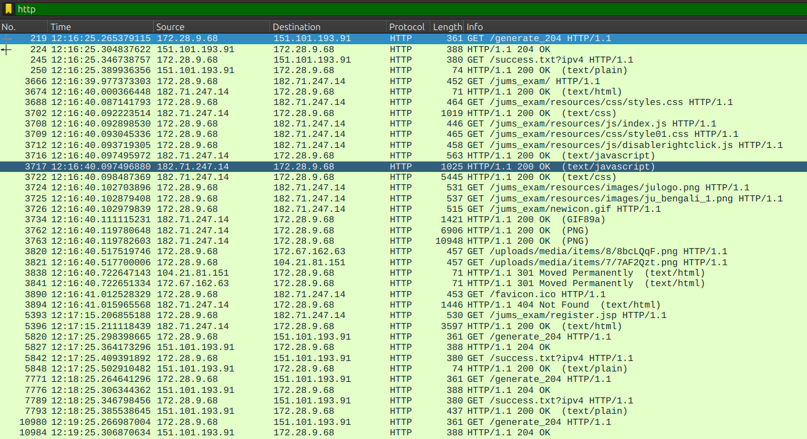

#### 2. TCP Display Filter (`tcp`):
Displays all TCP segments (handshakes, retransmissions, payload segments, ACKs, and teardowns).
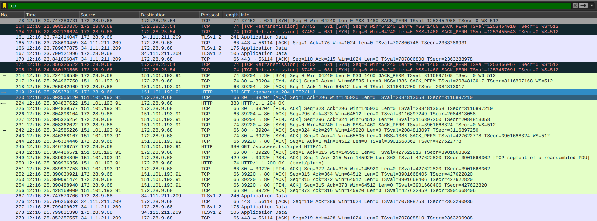

#### 3. DNS Display Filter (`dns`):
Displays DNS name queries and server responses on UDP/TCP port 53.
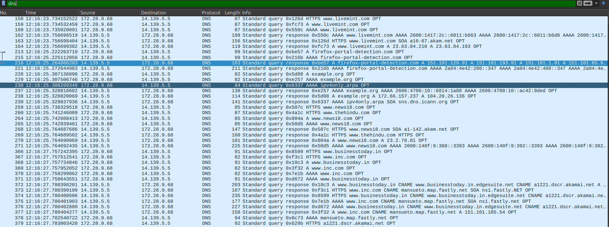

#### 4. UDP Display Filter (`udp`):
Displays connectionless datagram traffic (mDNS, SSDP, NBNS, LLMNR, DNS).
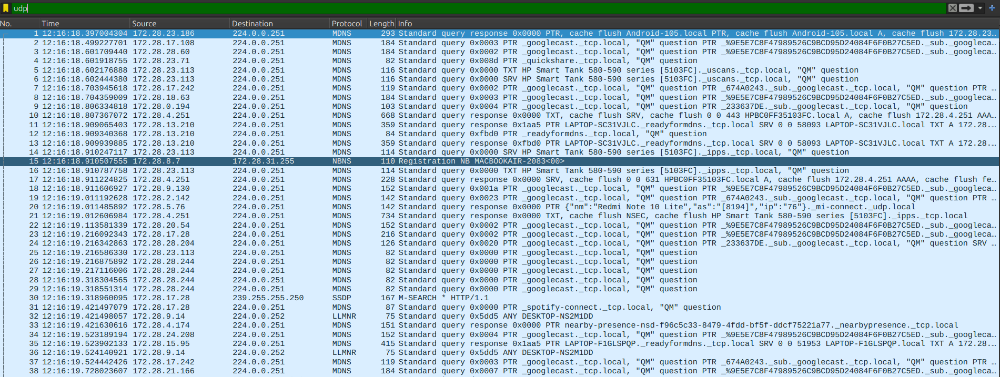

---

### Step 2: Following Network Conversations (Stream Reassembly)

Selecting a packet and navigating to **Right Click $\rightarrow$ Follow $\rightarrow$ UDP Stream** opens the conversational reassembly dialog. Wireshark strips the transport, network, and data-link headers and reconstructs the application payload.

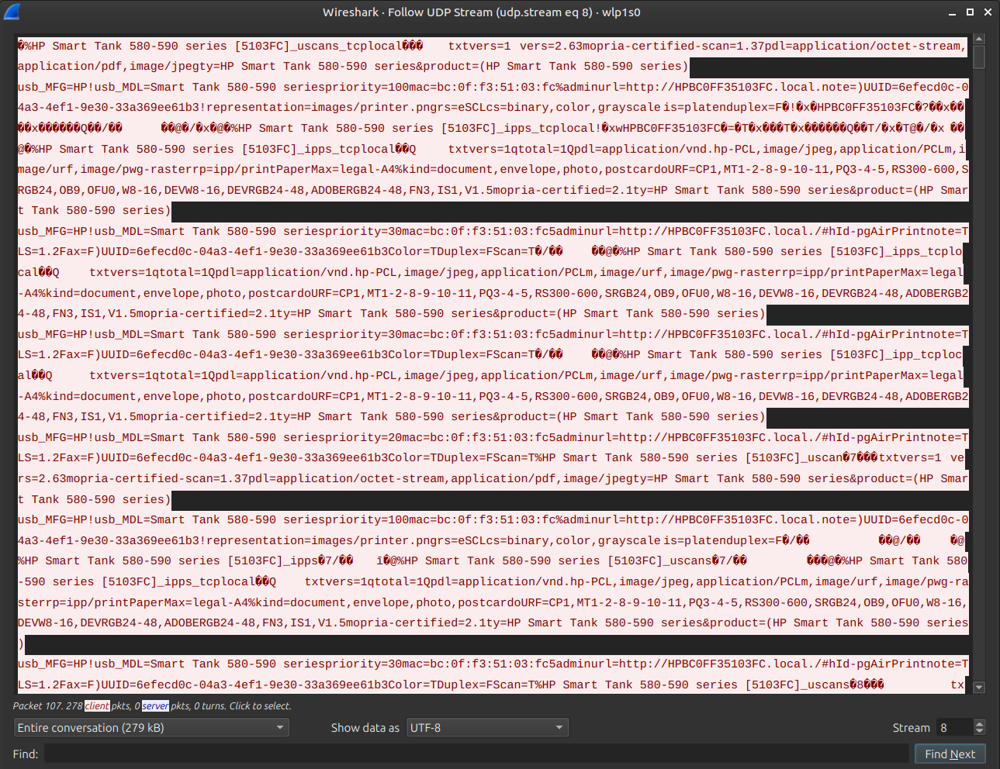

#### Analysis of Reassembled Stream (`udp.stream eq 8`):
The reconstructed stream captures Multicast DNS (mDNS) service discovery announcements broadcast on multicast port 5353 by a networked office printer:
- **Device Model:** `HP Smart Tank 580-590 series [5103FC]`
- **Advertised Services:**
  - `_uscans._tcp.local` (eSCL network scanning)
  - `_ipps._tcp.local` (IPP Secure printing)
  - `_ipp._tcp.local` (Internet Printing Protocol)
- **Extracted Device Metadata:**
  - Hostname: `HPBC0FF35103FC.local.`
  - Physical MAC: `bc:0f:f3:51:03:fc`
  - Admin Webpage: `http://HPBC0FF35103FC.local./#hId-pgAirPrint`
  - Supported PDLs: `application/octet-stream`, `application/pdf`, `image/jpeg`, `application/vnd.hp-PCL`, `image/urf`
  - Capabilities: `Color=T`, `Duplex=F`, `Scan=T`

---

## Question 6: Server HTTP Response and Ethernet Layer Inspection

### Question Statement
> *Search through your capture, and find an HTTP packet coming back from the server (TCP Source Port == 80). Expand the Ethernet layer in the Packet Details Panel.*

### Experimental Procedure
To isolate incoming HTTP responses originating from the web server on standard port 80, the display filter was applied:
```text
http and tcp.srcport == 80
```
Packet 224 was selected, and the **Ethernet II** protocol layer was expanded.

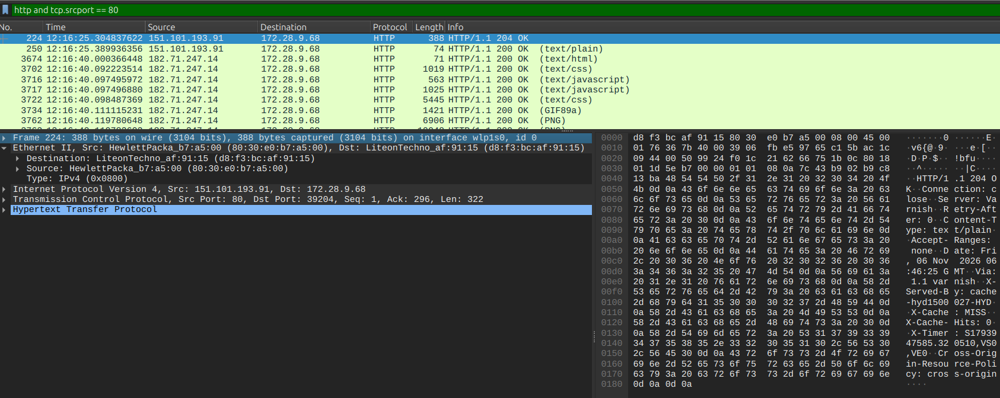

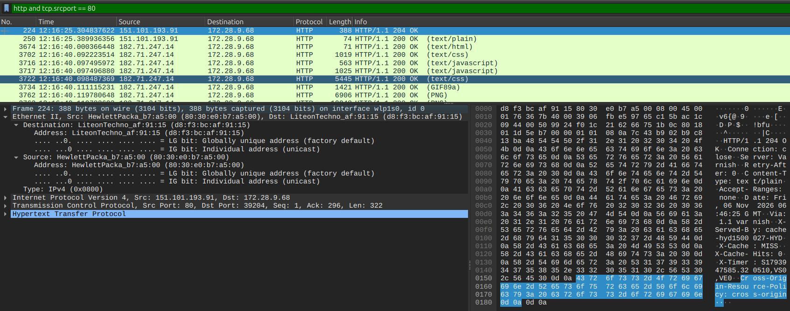

#### Ethernet II Header Dissection:
- **Frame Length:** 388 bytes on wire (3104 bits)
- **Destination MAC:** `LiteonTechno_af:91:15` (`d8:f3:bc:af:91:15`)
  - `.... ..0. ....` = LG bit: Globally unique address (factory default)
  - `.... ...0 ....` = IG bit: Individual address (unicast)
- **Source MAC:** `HewlettPacka_b7:a5:00` (`80:30:e0:b7:a5:00`)
  - `.... ..0. ....` = LG bit: Globally unique address (factory default)
  - `.... ...0 ....` = IG bit: Individual address (unicast)
- **Type:** `IPv4 (0x0800)`
- **Network Layer (IP):** Source `151.101.193.91`, Destination `172.28.9.68`
- **Transport Layer (TCP):** Source Port `80`, Destination Port `39204`
- **Application Layer (HTTP):** `HTTP/1.1 204 OK`

---

## Question 7: NIC Manufacturers (Local Host vs. Server / Gateway)

### Question Statement
> *What are the manufacturers of your PC’s Network Interface Card (NIC), and the servers NIC?*

### Observations from Packet 224:
1. **PC's Network Interface Card (NIC):**
   - **MAC Address:** `d8:f3:bc:af:91:15`
   - **Resolved Manufacturer Name:** **Lite-On Technology Corp.** (`LiteonTechno`)
   - *Physical Context:* This is the integrated 802.11ac Wi-Fi NIC installed in the student machine (`wlp1s0`).

2. **Server's / Gateway's Network Interface Card (NIC):**
   - **MAC Address:** `80:30:e0:b7:a5:00`
   - **Resolved Manufacturer Name:** **Hewlett Packard** (`HewlettPacka`)

### Crucial Computer Networking Insight:
A vital distinction must be noted regarding the "Server's NIC":
- In the TCP/IP stack, MAC addresses operate strictly at **Layer 2 (Data Link Layer)** and possess **hop-by-hop local scope**.
- The remote web server (`151.101.193.91`) resides across the global Internet, separated from the local host by multiple intermediate IP routers.
- Routers strip and rewrite the Layer 2 Ethernet header at every routing boundary.
- Therefore, the Source MAC address (`80:30:e0:b7:a5:00`) received by the host belongs to the **local default gateway router / access point** (manufactured by **Hewlett Packard / HP Enterprise**) that delivered the packet onto the local wireless LAN segment, rather than the remote server itself.

---

## Question 8: Organizationally Unique Identifiers (OUIs) in Raw Hex Bytes

### Question Statement
> *What are the Hex values (shown in the raw bytes panel) of the two NICS Manufacturers OUIs?*

### Theoretical Context
An **Organizationally Unique Identifier (OUI)** consists of the first **24 bits (3 bytes)** of a standard 48-bit IEEE 802 MAC address. The IEEE Registration Authority assigns OUIs to hardware manufacturers, while the vendor assigns the remaining 24 bits.

---

### Step 1: PC's NIC Manufacturer OUI (Lite-On Technology Corp.)
Selecting the Destination Address in Packet 224 highlights the first 6 bytes in the raw bytes pane:

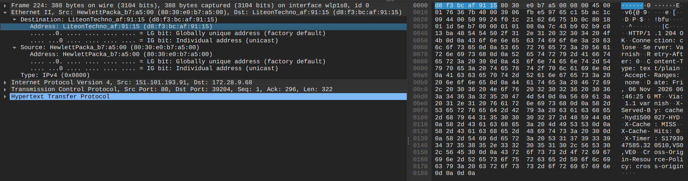

- **Full MAC Address:** `d8:f3:bc:af:91:15`
- **Highlighted Hex Bytes in Packet Bytes Panel:** `d8 f3 bc af 91 15`
- **First 3 Bytes (OUI):** **`d8:f3:bc`** (Hex: `d8 f3 bc`)
- **Vendor:** Lite-On Technology Corp.

---

### Step 2: Gateway / Server NIC Manufacturer OUI (Hewlett Packard)
Selecting the Source Address in Packet 224 highlights the next 6 bytes in the raw bytes pane:

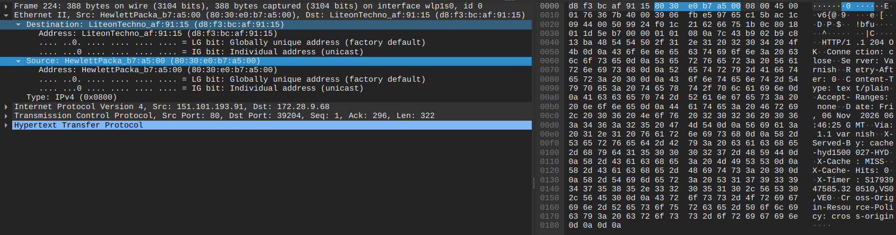

- **Full MAC Address:** `80:30:e0:b7:a5:00`
- **Highlighted Hex Bytes in Packet Bytes Panel:** `80 30 e0 b7 a5 00`
- **First 3 Bytes (OUI):** **`80:30:e0`** (Hex: `80 30 e0`)
- **Vendor:** Hewlett Packard

#### Summary Table:
| Node Role | Full MAC Address | Manufacturer OUI (First 3 Bytes) | OUI Manufacturer Identity |
|---|---|:---:|---|
| **PC Client NIC** | `d8:f3:bc:af:91:15` | **`d8:f3:bc`** | Lite-On Technology Corp. |
| **Gateway / Server NIC** | `80:30:e0:b7:a5:00` | **`80:30:e0`** | Hewlett Packard |

---

## Question 9: Protocol Hierarchy Statistics

### Question Statement
> *Find the following statistics:*
> - *a. What percentage of packets in your capture are TCP, and give an example of the higher level protocol which uses TCP?*
> - *b. What percentage of packets in your capture are UDP, and give an example of the higher level protocol which uses UDP?*

### Experimental Procedure
Navigated to **Statistics $\rightarrow$ Protocol Hierarchy** to obtain an aggregate breakdown of all 94,876 captured packets.

---

### Part 9a: Transmission Control Protocol (TCP) Statistics

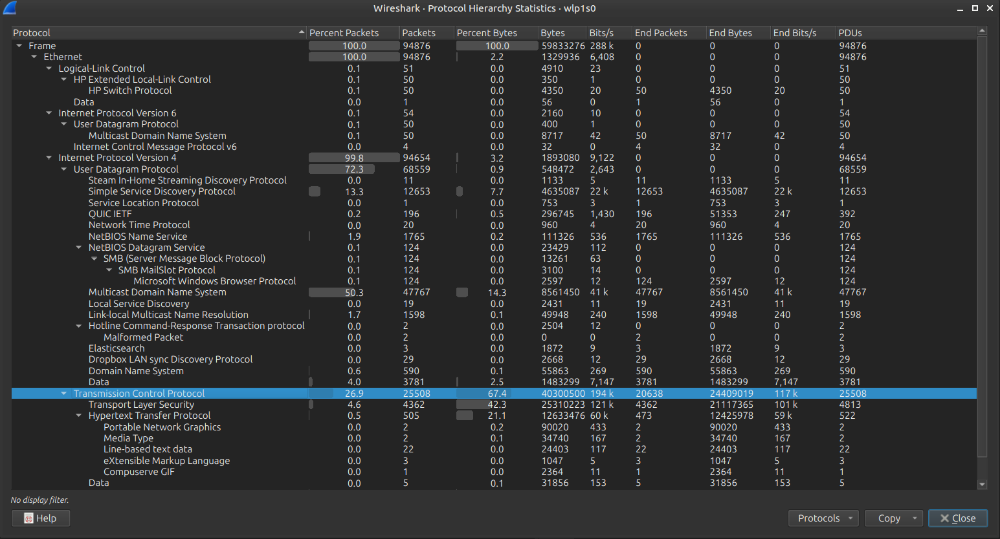

- **Total Packets in Capture:** 94,876 packets (59,833,276 bytes)
- **TCP Packet Count:** 25,508 packets
- **Percentage of Total Packets:** **`26.9%`**
- **Percentage of Total Bytes:** `67.4%` (40,300,500 bytes)
- **Higher-Level Protocols Using TCP:**
  - **TLS (Transport Layer Security):** 4,362 packets (**4.6%**)
  - **HTTP (Hypertext Transfer Protocol):** 505 packets (**0.5%**)
  - Line-based text data, PNG/GIF media streams, XML payloads.

---

### Part 9b: User Datagram Protocol (UDP) Statistics

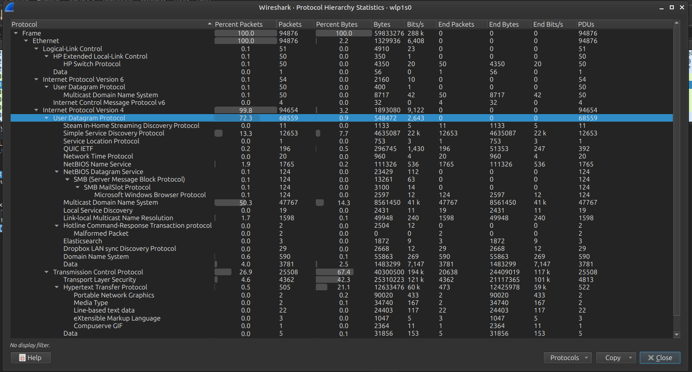

- **UDP Packet Count:** 68,559 packets
- **Percentage of Total Packets:** **`72.3%`**
- **Percentage of Total Bytes:** `0.9%` (548,472 bytes)
- **Higher-Level Protocols Using UDP:**
  - **mDNS (Multicast Domain Name System):** 47,767 packets (**50.3%**)
  - **SSDP (Simple Service Discovery Protocol):** 12,653 packets (**13.3%**)
  - **NetBIOS Name Service:** 1,765 packets (**1.9%**)
  - **LLMNR (Link-Local Multicast Name Resolution):** 1,598 packets (**1.7%**)
  - **DNS (Domain Name System):** 590 packets (**0.6%**)
  - **QUIC IETF:** 196 packets (**0.2%**)
  - **NTP (Network Time Protocol):** 20 packets (**0.0%**)

#### Comparative Distribution Table:
| Transport Protocol | Packet Count | Packet Percentage (%) | Byte Volume | Byte Percentage (%) | Higher-Level Application Protocols |
|---|:---:|:---:|:---:|:---:|---|
| **UDP** | 68,559 | **72.3%** | 548,472 | 0.9% | mDNS, SSDP, NetBIOS, LLMNR, DNS, QUIC, NTP |
| **TCP** | 25,508 | **26.9%** | 40,300,500 | 67.4% | TLS, HTTP, Web Media (PNG, CSS, JS) |
| *Other / Non-IP* | 809 | 0.8% | 18,984,304 | 31.7% | LLC, HP Switch Protocol, IPv6 ICMPv6 |

---

## Question 10: Traffic Flow Graph Analysis

### Question Statement
> *Find the traffic flow Select the Statistics->Flow Graph menu option. Choose General Flow and Network Source options, and click the OK button.*

### Experimental Procedure
Navigated to **Statistics $\rightarrow$ Flow Graph**, selected **Addresses: Network**, and evaluated both General Flow and TCP Flow views.

---

### Step 1: General Flow Graph (All Flows, Network Addresses)

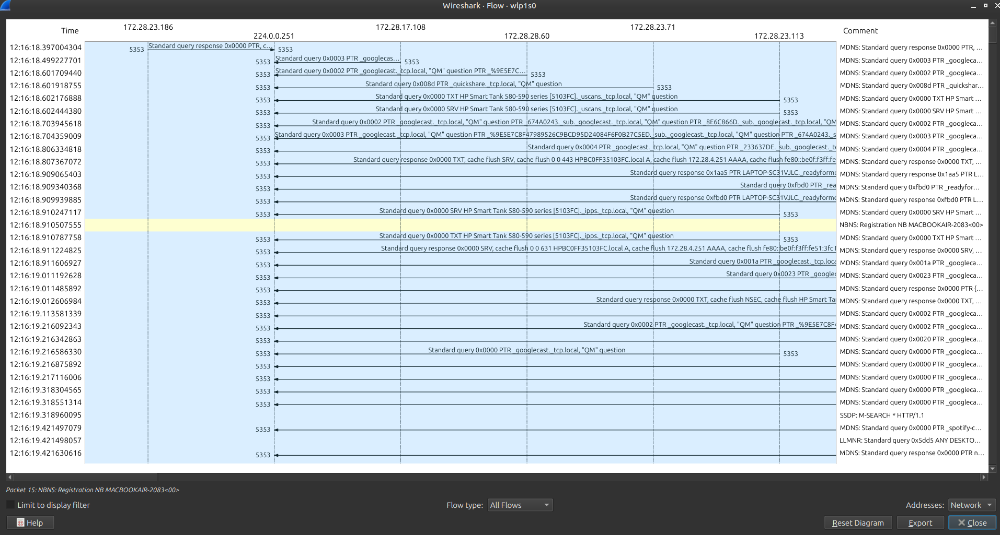

#### Flow Graph Analysis:
- The horizontal columns represent distinct network IP endpoints:
  - Multicast Group: `224.0.0.251` (mDNS)
  - LAN Nodes: `172.28.23.186`, `172.28.17.108`, `172.28.28.60`, `172.28.23.71`, `172.28.23.113`
- The vertical axis depicts elapsed time (12:16:18 to 12:16:19).
- Directional arrows illustrate high-frequency query/response transmissions between LAN endpoints and the mDNS multicast address, demonstrating peer-to-peer zero-configuration device discovery across the subnet.

---

### Step 2: TCP Flow Graph (TCP Connection Lifecycle)

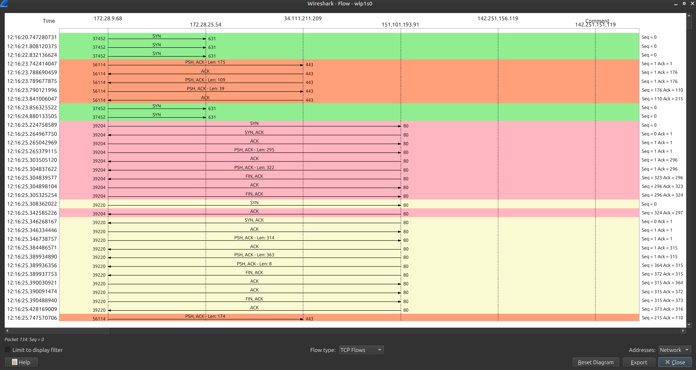

#### Analysis of the HTTP/TCP Connection Lifecycle:
The TCP Flow graph between the client computer (`172.28.9.68`) and the web server (`151.101.193.91`) provides a textbook visualization of the TCP state machine:

1. **Three-Way Handshake (Connection Establishment):**
   - $t_1$: Client transmits `SYN` (`39204 -> 80`, `Seq=0`).
   - $t_2$: Server replies with `SYN, ACK` (`80 -> 39204`, `Seq=0, Ack=1`).
   - $t_3$: Client transmits `ACK` (`39204 -> 80`, `Seq=1, Ack=1`).
2. **Data Transfer (HTTP Request and Response):**
   - $t_4$: Client pushes HTTP GET request: `PSH, ACK - Len: 295` (`Seq=1, Ack=1`).
   - $t_5$: Server acknowledges data receipt: `ACK` (`Seq=1, Ack=296`).
   - $t_6$: Server transmits HTTP 204 OK response: `PSH, ACK - Len: 322` (`Seq=1, Ack=296`).
3. **Connection Teardown (Four-Way Termination):**
   - $t_7$: Server initiates close: `FIN, ACK` (`Seq=323, Ack=296`).
   - $t_8$: Client acknowledges close: `ACK` (`Seq=296, Ack=323`).
   - $t_9$: Client initiates close: `FIN, ACK` (`Seq=296, Ack=324`).
   - $t_{10}$: Server acknowledges: `ACK` (`Seq=324, Ack=297`).

---

## Conclusion and Key Learnings

1. **Layer Encapsulation:** Live traffic inspection confirmed how application data (HTTP/DNS) is encapsulated inside transport headers (TCP/UDP), which are nested inside network packets (IPv4), and wrapped in data link frames (Ethernet II).
2. **ARP and Link-Layer Dynamics:** Address resolution via ARP broadcasts is indispensable for mapping logical IP addresses to 48-bit physical MAC addresses on shared broadcast domains.
3. **Hop-by-Hop MAC Rewriting:** Wireshark inspection reinforced the fundamental principle that MAC addresses do not survive IP routing boundaries; the source MAC of an inbound Internet packet identifies the local default router rather than the remote server.
4. **Transport Trade-offs:** The capture evidenced a clear division between TCP (used for reliable, bulky HTTP/TLS data transfer accounting for 67.4% of total bytes) and UDP (used for lightweight, high-frequency multicast device discovery and name resolution accounting for 72.3% of total packets).
5. **Conversational Reassembly:** Following TCP/UDP streams removes protocol encapsulation overhead, enabling complete inspection of application-layer payloads and REST transactions.

---

### References
1. Kurose, J. F., & Ross, K. W. *Computer Networking: A Top-Down Approach*, 8th ed., Pearson, 2021.
2. Tanenbaum, A. S., & Wetherall, D. J. *Computer Networks*, 5th ed., Prentice Hall, 2011.
3. Wireshark Documentation: *Wireshark User's Guide*, https://www.wireshark.org/docs/wsug_html_chunked/.
4. IEEE 802.3 Standard for Ethernet Physical Layer and MAC Sublayer Specifications.
